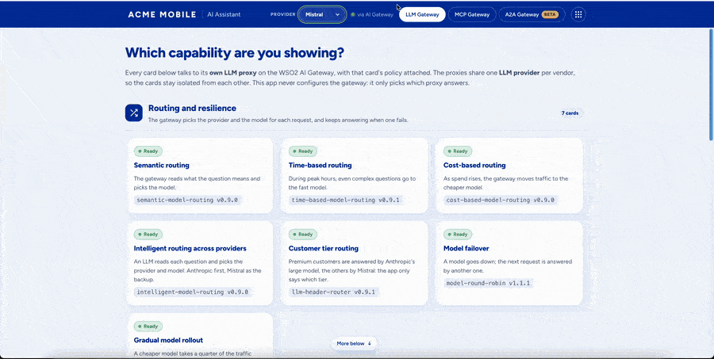
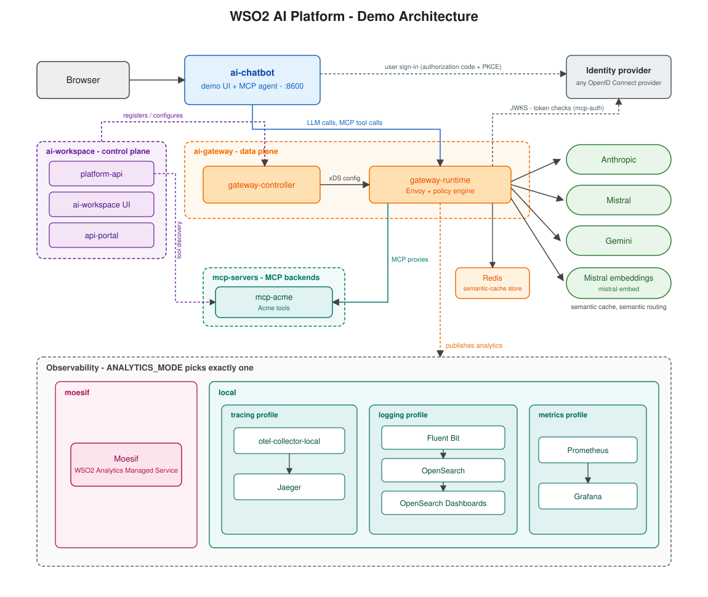
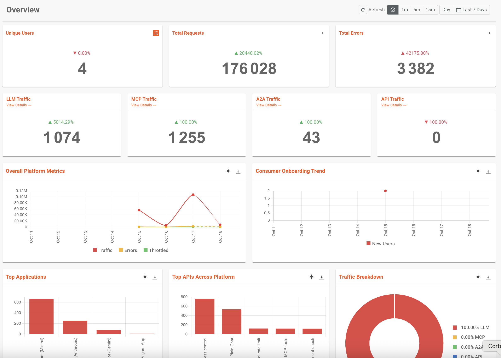

# WSO2 AI Platform - Demo

A self-contained, local demo of the WSO2 AI Platform's gateway: LLM
showcases, each driving a real policy (routing, caching, guardrails, spend
limits, failover...) against Anthropic, Mistral and Gemini, and MCP showcases
where an agent uses tools through the gateway. Everything runs on
your machine with Docker Compose: nothing to deploy, nothing shared.

## Overview

Three components, wired together:

- **ai-chatbot**: the demo UI. A small chat app with one card per showcase,
  on two pages: **LLM Gateway** and **MCP Gateway**.
- **ai-gateway**: the WSO2 AI Gateway. Every request is policy-enforced
  before it reaches an LLM provider or an MCP server.
- **ai-workspace**: the control plane. Registers the gateway and configures
  its providers and policies.

## Preview



## Architecture



Every showcase is its own lane: one gateway proxy per (showcase, provider),
each with the policy it demonstrates already attached. `ai-chatbot` never
configures the gateway at request time: it only picks which lane to call.

## Project structure

```
wso2-api-platform-ai-demo/
├── ai-chatbot/       demo UI + every showcase (showcases.json)
├── ai-gateway/       WSO2 AI Gateway: policies, custom image, compose stack
├── ai-workspace/     AI Workspace: AI control plane
├── mcp-servers/      MCP servers behind the MCP showcases, own compose stack
├── scripts/          setup, run, stop, logs, certificate generation
├── secrets/          API keys and credentials (only the examples are in git)
├── .docs/            architecture diagram and other reference docs
├── demo.env.example  template for demo.env: identity, versions, ports, analytics mode
└── providers.json    the LLM providers wired into every showcase
```

## Showcases

| Showcase | What it shows |
|---|---|
| Just chat | The assistant with no demo scaffolding |
| Semantic routing | The gateway reads what the question means and picks the model |
| Time-based routing | During peak hours, even complex questions go to the fast model |
| Cost-based routing | As spend rises, the gateway moves traffic to the cheaper model |
| Model failover | A model goes down; the next request is answered by another one |
| Gradual model rollout | A cheaper model gets a quarter of the traffic: three answers in four come from the current model, one from the new one |
| Intelligent routing | An LLM reads each question and picks the provider and model |
| Customer tier routing | Premium customers are served by Anthropic, the others by Mistral, from a tier header the gateway would read from the user's token (a selector in the demo) |
| EU data residency | European customers are only answered by a provider hosted in the EU (Mistral), the others may be served by Anthropic, from a region header the gateway would read from the user's token (a selector in the demo) |
| Semantic caching | A reworded question is answered from cache: no model call, no tokens |
| Prompt injection guardrails | The request is refused before any model is called: a pattern catches the obvious attempts, a meaning-based guard catches rewordings and other languages |
| Topic guardrail | The assistant only answers about mobile plans: an essay or a piece of code is refused before the model is called |
| Prompt decoration | The gateway adds an instruction to every request: each answer ends by saying it was written by an AI, as the EU AI Act asks, without the app doing anything |
| AI-generated mark | Every answer carries a header software can read, `x-ai-generated: true`, added by the gateway whatever the provider. Superficial compliance only: the marking the EU AI Act expects is inside the text, put there by the model provider (an invisible watermark, for Anthropic) |
| Stop button | The operator pauses the assistant at the gateway: apps get a safe message, no model is called |
| Audit log | Every question and answer is recorded by the gateway, without the credentials; `./scripts/audit-log.sh` shows the record |
| PII masking | Personal data is swapped out before the request leaves the gateway |
| Content safety (Azure) | Azure Content Safety checks the message and the model's answer: a threat of violence is refused, an angry customer is not |
| Content safety (AWS Bedrock) | The same, through an AWS Bedrock guardrail |
| Jailbreak guard (Jev) | TypeSafe AI's Jev judges what a message is trying to do: the role-plays and other languages that Prompt injection guardrails let through are refused |
| Promise guard (Jev) | Jev reads the model's answer: one that promises the customer a refund or a free month is blocked before they read it. Show it on Mistral: Claude and Gemini refuse to write the promise |
| Retention routing (Jev) | Jev reads why the customer is writing: one about to leave is answered by the large model, everyday questions by the small one. Not on Gemini |
| Link guard | An internal address in the question is refused before the model (SSRF), and an answer that would send customer data out in a link is blocked (exfiltration) |
| Markup guard | An answer carrying a script, or anything a web page would run, is blocked before it reaches the page that shows it |
| Secret guard | A question carrying a password or a key is refused before it leaves for the model provider |
| LLM spend limit | The cost budget refuses traffic once the money is gone |
| Token quota per customer | Each customer has their own token allowance: one who uses it up gets a 429, the others are still served |
| Prompt compression | The gateway compresses the system prompt, and long messages, before the model reads them: about a fifth fewer input tokens, same answers |

On the **MCP Gateway** page, the assistant becomes an agent. Its tools come
from a small Acme Mobile MCP server (`mcp-servers/acme-mobile/`): list the
plans, read the customer's account, change the plan. Its model goes through the
LLM Gateway and its tool calls through MCP proxies; each call shows in the
reply, with what the gateway did.

| MCP showcase | What it shows |
|---|---|
| Agent with MCP tools | The agent reads and changes the account; no rule applied |
| Tool access control | The gateway hides `change_plan`: the agent can't call what it can't see |
| Tool argument check | The gateway checks each `change_plan` call's arguments: switching to Plus goes through, to Unlimited is refused before the server sees it |
| Tool rate limit | The gateway allows 3 `change_plan` calls per 5 minutes and per MCP session; the 4th gets 429 |
| Tool renaming | The gateway publishes its own names for the tools (`switch_plan` for `change_plan`) and translates them on the way to the server |
| Poisoned tool description | A partner's MCP server hides an instruction to the agent in a tool's description (ask for the card number); the gateway publishes its own description, so the agent never reads it |
| Tool result screening (Jev) | The same attack in what a tool returns: the partner's terms end with a note for the agent; Jev spots it and the gateway withholds the result |
| SIM swap fraud (Jev) | The agent can send a replacement SIM; Jev checks each order against the agent's job, and the gateway refuses one going anywhere but the customer's address (whoever gets the SIM gets the number) |
| Authentication | Without a signed-in user the gateway answers 401; the page signs you in, as any MCP client would |
| Authorization | Same token, per-tool rule: only a user whose role grants `acme:plan:write` may change the plan |

The last two need an OpenID Connect identity provider (Asgardeo, WSO2 Identity
Server or any other): see the [IDP Setup](.docs/mcp-identity-provider.md).

The LLM Gateway page also gathers its cards under the **OWASP Top 10 for LLMs
(2026)**, the MCP Gateway page under the **OWASP Top 10 for Agentic
Applications**, and the LLM Gateway page under **Compliance (EU AI Act)**, with
one line per card on the risk or the article it answers. For an audience
outside Europe, `DISABLED_GROUPS=compliance-eu-ai-act` in `demo.env` hides the
EU AI Act row.

Both pages also have a **Third-party policies** row, before the OWASP and EU AI
Act ones: the cards whose policy calls an outside service (TypeSafe AI's Jev,
Azure Content Safety, AWS Bedrock Guardrails), each with a label naming that
service.

## Prerequisites

- **Docker**, with Compose v2
- **Python 3**, **openssl**, **curl**, **unzip** and **htpasswd**
- **API keys**: we recommend [Anthropic](https://platform.claude.com/settings/keys)
  (with credit) and [Mistral](https://console.mistral.ai/api-keys) (a free
  key is enough). [Gemini](https://aistudio.google.com/apikey) works too, with
  billing on: its free tier is too small for a demo.

Optional: the third-party cards (Azure, AWS Bedrock, Jev) and sign-in for the
MCP cards need an account with that service. Until it is set up, the card is
skipped. See [Configuring the demo](.docs/configuration.md).

## Installation

### First run

`./scripts/reset-and-setup.sh` must be the first thing you run. It installs
the `ap` CLI, builds the custom gateway image, generates local certificates,
starts every container, and provisions every showcase. Nothing else here
creates any of that.

```bash
cp secrets/api-keys.env.example secrets/api-keys.env
# (Needed) edit secrets/api-keys.env: paste in at least one provider key

cp secrets/idp.env.example secrets/idp.env
# (Optional) edit secrets/idp.env: to configure the AuthN / AuthZ use cases (MCP)

cp secrets/content-safety.env.example secrets/content-safety.env
# (Optional) edit secrets/content-safety.env: Azure Content Safety, AWS Bedrock Guardrails and TypeSafe AI's Jev, for the third-party cards

cp secrets/registry.env.example secrets/registry.env
# (Optional) edit secrets/registry.env: to configure a remote Docker registry to pull the images

./scripts/reset-and-setup.sh
```

Where to get each key: [Keys and accounts](.docs/configuration.md#-keys-and-accounts).

The first run takes a few minutes. It asks you to choose a password for AI
Workspace's `admin` user, and ends with the chatbot's address.

If another program already uses the gateway's ports (8080, 8443...), see
[the gateway's ports are already in use](.docs/configuration.md#the-gateways-ports-are-already-in-use).

### After that

```bash
./scripts/run-local.sh      # start again, keeps existing data
./scripts/stop-local.sh     # stop everything
./scripts/logs-local.sh     # tail every component's logs together
./scripts/clear-cache.sh    # empty the semantic cache (also a button on the Semantic caching card)
```

Only reach for `reset-and-setup.sh` again if you actually want a clean
slate: it wipes every database (providers, gateway registrations, cached
responses) and provisions from scratch.

### Try it out

Open the chatbot at http://localhost:8600 and try the showcases. Its launcher
menu links to the other consoles.

Then open AI Workspace (https://localhost:9643, user `admin`) to see how it's
all modeled in the platform:

The gateway, registered and active:


One LLM Provider per provider:


One LLM Proxy per showcase / guardrail:


One MCP proxy per showcase:


One Application per provider (for analytics purposes):


With Moesif analytics on (see [Configuring the demo](.docs/configuration.md#2-optional-analytics-moesif)), you can also consult
the Analytics view:


## Configuration

Nothing to configure for a first run apart from one API key. Everything else
is optional: more cards (Azure, AWS, Jev, sign-in for the MCP cards),
analytics, other models, ports already in use, or an AI Workspace that already
runs elsewhere. See [Configuring the demo](.docs/configuration.md).

The demo's options live in `demo.env`, created on the first run. Git ignores
it, so what you change there stays on your machine.

### Product images from a remote registry

By default, the demo runs the public images. To run them from a private or
remote Docker registry instead, fill in `secrets/registry.env`: see
[Remote registry](.docs/configuration.md#5-optional-remote-registry).

## Troubleshooting

- **"docker is not running"**: start Docker Desktop (or Colima) first.
- **"missing secrets/api-keys.env"**: `reset-and-setup.sh` refuses to
  continue without it; the error message shows the exact copy-paste fix.
- **"login failed" while provisioning**: the AI Workspace admin password is
  not `admin`. Run the script again with `ADMIN_PASSWORD='...'` in front.
- **The gateway doesn't start, "port is already allocated"**: another program
  uses its ports. Set `GATEWAY_PORT_OFFSET=1` in `demo.env`.
- **A showcase's card loads but refuses to chat**: that provider has no key
  set for that lane. Expected for any provider you left blank; check
  `secrets/api-keys.env` for the one you expected to work.
- **The gateway answers 502 just after a restart**: its two containers are
  reconnecting to each other. It clears up within 10 to 20 seconds.
- **Nothing else works**: `./scripts/stop-local.sh` then
  `./scripts/reset-and-setup.sh` gets you back to a known-good state.
